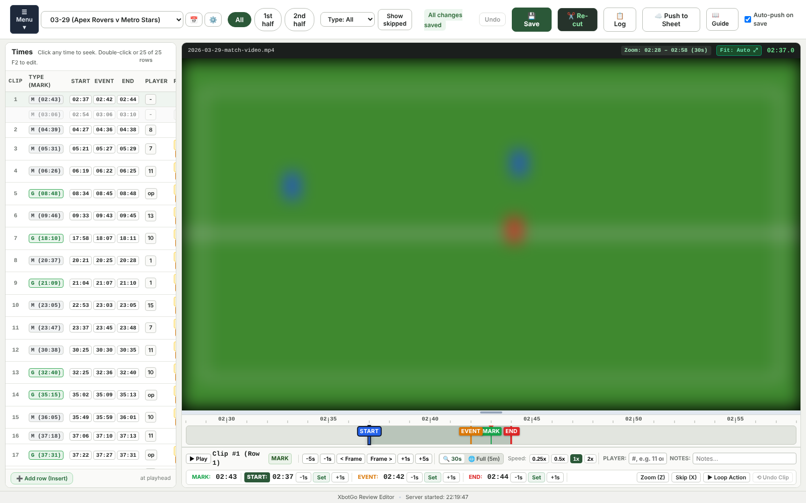
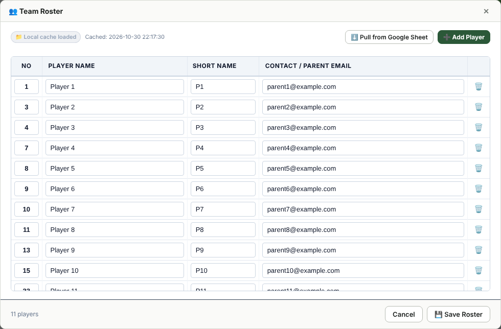
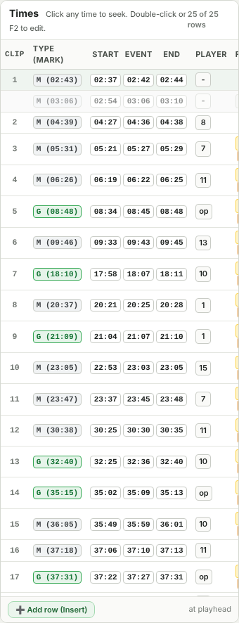
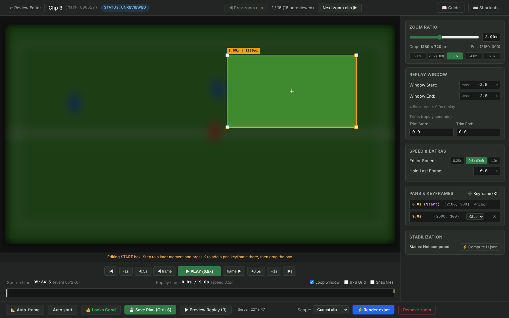
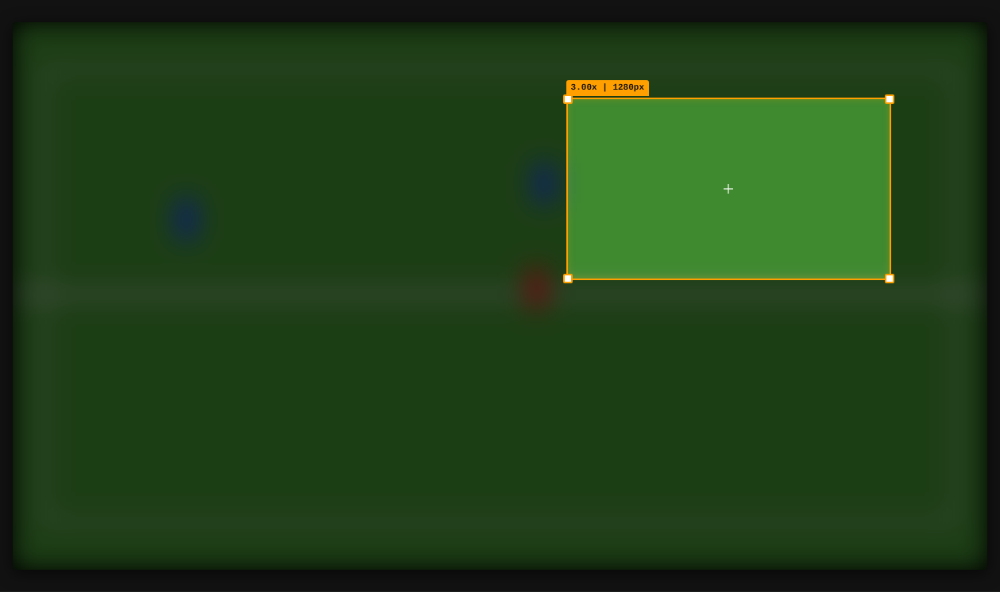
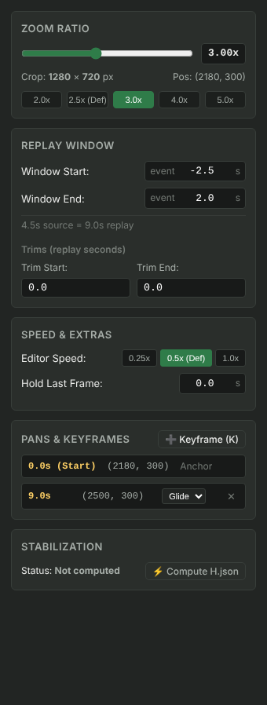
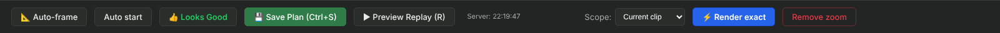

> Unofficial community tool, not affiliated with or endorsed by XbotGo.
> This page is generated from the in-app guide. A styled version is available on GitHub Pages: see the README.

# XbotGo Review & Zoom Editor Guide

Welcome! This guide is written for anyone using the **XbotGo Review Editor** and **Zoom Replay Editor** for the first time. Learn how to navigate your match footage, refine clip timings, tag players, and craft 720p zoom replays with smooth pan tracking.

## 🚀 60-Second Quick Start

If you're in a hurry to review a soccer match, here is the entire workflow in 3 steps:

- **1. Launch & Select Game** - Double-click `review_editor.bat`. Pick your game date from the top-left dropdown or click 📅.
- **2. Watch & Refine Timings** - Click any row in the table. Drag the Start (green), Event (amber), or End (red) handles on the timeline.
- **3. Save & Push to Sheet** - Press <kbd>Ctrl + S</kbd> anytime. Changes save atomically to disk and auto-push to Google Sheets!

> **Tip.** **The Review Editor rule:** It edits timings and review flags only. Video cutting, highlight reels, and final zoom mp4 encoding stay with the downstream pipeline scripts (`sync_game.py` and `make_run_all.py`).

## 🧰 One-Time Setup (new PC or new user)

Do this once. The project lives in `XbotGo` project folder (any location works; keep the folder layout inside it).

| What | How |
|---|---|
| **1. Python 3.10+** | Install from python.org or the Microsoft Store, then check: `python --version` |
| **2. Python packages** | In the project folder: `pip install -r requirements.txt` (flask, gspread, numpy, opencv-python, Pillow) |
| **3. Helper programs** | ffmpeg, ffprobe and tesseract are already in `utils\`; nothing needs the Windows PATH. Check: `utils\ffmpeg\bin\ffmpeg -version` |
| **4. Google Sheet access (optional)** | Put the service-account key (`.json`) in `shared\secrets\` and share the workbook with that account's e-mail as Editor. Test: `python tools\pipeline\sheet_sync.py tabs` lists the tabs. Without it the editor still works; only Push to Sheet and Roster pull fail. |
| **5. Logos and music** | Crests and league logos go in `shared\team_logos\`, music beds in `shared\Music\`. A new opponent crest can also be added with Upload in Game Setup. |
| **6. Start the editor** | Double-click `review_editor.bat` (opens http://127.0.0.1:5000). If it says another copy is running, close that window first. |

## ✅ Complete First-Game Checklist (Step-by-Step)

Follow this 10-step sequence to process any brand-new match from raw dump to final 4K video:

- **Step 0: Copy Smartphone Match Footage & App Dump** - Connect smartphone via USB (File Transfer mode). Connect the phone by USB (File Transfer mode). Make a PC folder named `MM-DD-YY` (e.g. `04-01-26`) and copy into it: the match videos (phone `DCIM/XbotGo`) as `04-01-26/Videos/*.mp4`, and the whole `Android/data/com.blink.blinkfocos` folder as `04-01-26/com.blink.blinkfocos/`. (The older `DCIM/XbotGo` + `Android/data/...` layout is still understood.) The editor lists the new date in yellow as a **Dump**.
- **Step 1: Scaffolding / Discovery** - Open editor, click 📅 or pick date. If first time loading, the editor discovers the dump folder, extracts timeline, and generates initial review CSV.
- **Step 2: Game Setup Wizard (☰ Menu ▾ → Game Setup)** - Set Home Team (pre-filled from Defaults) & Crest, Opponent Team & Crest, League (from your configured leagues), Final & Halftime scores, and Match Name.
- **Step 3: Generate Title Cards (🎦 Generate Cards in Wizard)** - Renders Intro, Half-time, and Outro title cards (`000_intro_fullgame.mp4`, etc.) using chosen crests and team names.
- **Step 4: Refine Clip Timings in Times Table** - Navigate clips. Drag Start/Event/End handles on the timeline. Ensure Start ≤ Event ≤ End (the editor warns and blocks saving if invalid).
- **Step 5: Atomic Save & Push to Google Sheet** - Press <kbd>Ctrl + S</kbd> or click 💾 Save. Writes reviewed CSV with timestamped `.bak` sibling and synchronizes with your Google Sheet tab.
- **Step 6: Fast Re-cut Changed Clips (🔄 Re-cut)** - Cuts edited clips locally and re-assembles the local preview reel. Logs persist server-side in `tmp/task_logs/`. The log window closes by itself when the run succeeds (untick **auto-close** to keep it open, even mid-run); the **📋 Log** button reopens the last log. The same applies to Generate review. **Honest status:** if any clip fails to cut or the preview reel check fails, the log ends with `ERROR: Re-cut finished with errors` listing the clips, the dialog shows a failure instead of "Completed successfully", and nothing is reported as done.
- **Step 7: Craft Zoom Replays (🔍 Edit zoom)** - Review framing for each zoom replay. Adjust crop box, drop pan keyframe (<kbd>K</kbd>) if play moves across frame, test preview (<kbd>R</kbd>), and press <kbd>Ctrl + S</kbd> to save plan. *Unreviewed silent center crops are strictly blocked from rendering!*
- **Step 8: Render & Verify Zoom Replays (▶ Render exact / All)** - Renders 720p previews with `verify_zoom.py` edge/length verification. If any clip is missing or flagged, the drawer ends RED with a clear failure alert.
- **Step 9: Featured Player Spotlight Reels (☰ Menu ▾ → Featured Player)** - Select featured roster player(s) (e.g. #7 Chloe Bennett or #10 Ava Patterson). Generates team highlight reel plus individual player spotlight reel(s). The reel pipeline shows a progress line per stage in the log window ([clips], [replays], [reels], team highlights done); it can take 30-50 minutes for a full game, and you can close the window and reopen it from the menu.
- **Step 10: Final 4K Production (☰ Menu ▾ → Final 4K Production)** - Runs 6 pre-flight checks, generates serial batch script (`run_everything_<date>.bat`), shows the exact command, and launches after explicit confirmation. Safe to pause and resume!

## ⚡ How to Launch the App

Everything runs 100% locally on your computer with zero external server dependencies:

- **Method 1 (Recommended):** Double-click <kbd>review_editor.bat</kbd> in the project root folder (`review_editor.bat`). It automatically checks the port, launches the local server, and opens your default browser at `http://127.0.0.1:5000`.
- **Method 2 (Command Line):** Open PowerShell, navigate to the folder, and run: python tools\editor\server.py

> **Info.** **Duplicate Launch Protection:** If the editor is already running, starting a second copy will print: `Editor is already running on port 5000 (started HH:MM:SS). Close that window first.` This protects your CSV files and prevents background conflicts.

## 🖥️ Review Editor Workspace Overview

When you load a game (e.g. `2026-03-29`), the interface is split into three coordinated zones:

***Figure 1:** The 3-panel workspace: **Left** = Times Table; **Center** = Video & Timeline Slider; **Right** = Inspector Panel.*

### 🖥️ Viewport Auto-Fit & Splitters

- **Zero-Scrollbar Layout:** The interface is engineered to fit within your browser window with zero page-level scrollbars at standard resolutions (1600×900, 1920×1080).
- **Auto 16:9 Max Fill (<kbd>Fit: Auto ⤢</kbd>):** The video player automatically maximizes vertical height while strictly preserving a 16:9 video aspect ratio. The active `Fit: Auto ⤢` pill in the top-right video meta bar confirms this mode.
- **Horizontal Video Resizer:** Drag the horizontal splitter bar below the video player up or down to customize video height to your preference. The pill updates to `Fit: Custom ↕`. If you shrink the video, the bottom controls panel automatically expands cleanly with zero dark dead space underneath.
- **Double-Click or Pill Reset:** Clicking the `Fit: Custom ↕` pill or double-clicking the horizontal resizer instantly snaps the video back to pure `Fit: Auto ⤢`.
- **Vertical Column Splitter:** Drag the vertical divider between the times table and video player to rebalance horizontal screen real estate.

## 📱 Ingesting Match Footage & App Dump from Smartphone

After recording a match, transferring everything from your smartphone to your PC takes less than two minutes. You only need to copy two folders — no hunting for individual files:

> **Info.** **Step 1: Connect Phone in Transfer Mode**  Connect your Android smartphone to your PC via USB. On the phone screen, select **File Transfer / MTP (Transfer files)** mode.

> **Info.** **Step 2: Create a Match Folder on PC**  In your project workspace (the project folder), create a new folder named after the match date formatted as `MM-DD-YY` (for example, `04-01-26`).

### 📂 What to Copy (Grab the Entire Folders)

| Item | Where to find it on Phone (Internal Storage) | Where to copy on PC (e.g. `04-01-26/`) |
|---|---|---|
| **1. Match Videos** | `DCIM/XbotGo/` (or `DCIM/`) | Copy directly into `<day>/Videos/` or `<day>/DCIM/` |
| **2. Entire App Dump** | `Android/data/com.blink.blinkfocos/` | Copy the entire **`com.blink.blinkfocos`** folder directly into `<day>/` |

> **Warning.** **Zero Hunting Required:** Do not search for individual log files, `time.txt`, or metadata. Just grab the entire **`com.blink.blinkfocos`** folder. The Review Editor's discovery engine automatically walks the folder and extracts all tracking logs, court calibrations, and timestamps.

### ⚡ 1-Click Auto-Generation in Review Editor

Once both folders are copied into your match directory (e.g. `04-01-26\` inside the project folder):

1. Click the **📅 Calendar** button on the top bar of the Review Editor.
2. The match date will automatically appear with a green badge: Video dump detected.
3. Click on that date. The editor automatically parses the telemetry, aligns timestamps, constructs the match timeline, and generates the initial review table in one click!

## ☰ The Application Menu (☰ Menu ▾)

To provide clean, immediate desktop ergonomics, the **☰ Menu ▾** button sits first on the far left of the top bar, followed by the game selector, calendar button, and game settings:

- **⚙️ Game Setup...**: Configure match name, home & opponent teams, crests, league logos, scores, browse recording dumps from calendar, and generate title cards.
- **👥 Team Roster...**: Open the high-contrast spreadsheet modal to edit player jersey numbers, full names, short names, and parent contact emails with automatic bidirectional Google Sheet sync and local caching.
- **🌟 Featured Player & Reels...**: Open the team roster, select featured player(s), and generate player highlight reels.
- **🚀 Final 4K Production...**: Run automated pre-flight checks, generate the master batch script (`run_everything_<date>.bat`), and launch 4K encoding.
- **🧹 Tidy Output Folder...**: Reorganize match outputs into canonical subfolders (`final/`, `work/`, `_to_delete/`) with preview dry-run.
- **🔄 Re-cut Changed Clips**: Fast local cut of all edited clips and instant regeneration of the local preview reel.
- **📖 User Guide**: Open this interactive user guide.

## 👥 Team Roster Management (☰ Menu ▾ → Roster...)

Click **☰ Menu ▾ → Roster...** to open the full-screen Team Roster modal. This provides an editable spreadsheet interface to manage player records with automatic bidirectional synchronization between your local computer and your remote Google Sheet (**Roster** tab).

***Figure:** Team Roster spreadsheet editor with Jersey No, Player Name, Short Name, Parent Contact Email, live Google Sheet sync status badge, and Pull/Save actions.*

### ✨ Key Roster Features

- **High-Contrast Spreadsheet Styling:** Clean black-on-white layout with distinct columns: `No` (centered), `Player Name`, `Short Name` (used on title cards), and `Contact / Parent Email`.
- **Exact Order Preservation:** Preserves the exact original row sequence from your Google Sheet without forced sorting or rearrangement.
- **Add & Delete Players:** Click **➕ Add Player** to append a new row, or click **🗑️** to remove a player.
- **Dual-Target Save:** Clicking **💾 Save Roster** writes directly to your local cache at `out/reviewed/roster.csv` (with an automated timestamped `.bak` backup) and updates the Google Sheet `Roster` worksheet simultaneously.
- **Cache Freshness & Pull:** The modal continuously verifies freshness against Google Sheet. If updates were made directly in Google Sheets, click **⬇️ Pull from Google Sheet** to re-sync local cache instantly.
- **Downstream Script Integration:** Highlight reels (`make_reels.py`) and clip slicing (`cut_reviewed.py`) automatically read full names, numbers, and parent emails directly from this unified cache.

## ⚙️ Game Setup Wizard & Title Cards

When loading a brand-new match, the wizard prompts you to configure all game metadata in one place:

- **Match Name (CSV Game Column):** E.g. `2026-03-29 Apex Rovers v Horizon City SC`. Saving propagates this match name to the `game` column across all active rows in the review CSV!
- **Home Team & Crest:** Pre-filled from your configured defaults (e.g. **Apex Rovers** with your official club crest). **⚙️ Defaults Configuration (`⚙️ Defaults...` button):** Located at the top right of the Game Setup header. Allows configuring your team name, home/away role, crest, default league, featured spotlight players, and Google Sheet spreadsheet ID in `config/game_defaults.json`. These defaults automatically prefill all new game setups! You can customize the name, pick any logo from `shared/team_logos/`, or upload a new crest with `➕ Upload Logo...`.
- **Opponent Team & Crest:** Type the opponent name (with autocomplete suggestions from logo files) and select their official club crest.
- **League Competition:** Switch between the leagues listed in `config/game_defaults.json`, or **Other (Custom)**. Selecting "Other" allows entering a custom competition name and selecting or uploading a custom competition logo.
- **Scores & Strict Validation:** Enter final score (e.g. `6-0`) and halftime score (e.g. `3-0`). Team names cannot be empty and scores must match standard `H-A` format.
- **Logo Upload (`➕ Upload Logo...`):** Direct in-browser upload of transparent PNG or JPG logos into `shared/team_logos/` with automatic filename sanitization, immediate preview selection, and overwrite protection.
- **Google Sheet Tab Auto-Rename:** When saving game setup info, the sheet sync service automatically renames the target worksheet tab in your Google Sheet in place (e.g. `10/25 Apex v Horizon`) to keep your workbook organized without duplicating tabs.
- **🎦 Generate Cards Button:** Click this button inside the wizard to generate Intro, Halftime, and Outro title cards immediately (`make_reels.py --stage cards`). If team names, scores, or logos change later, the editor detects stale cards and prompts you to regenerate them.

## 🌟 Featured Player & Highlight Reels

You can create dedicated spotlight reels for any player on your roster:

- **Live Match Clip Counts:** The roster table analyzes your review CSV in real time and displays how many non-skipped clips feature each player.
- **Multi-Player Selection:** Check one or multiple players (defaults to your configured featured player, e.g. #11). The reel generator will build dedicated spotlight reels for every selected player in one pass!
- **Automatic 0-Clip Skipping:** Players who did not participate in any clips in this match are greyed out with a `(0 clips - skipped)` badge so you never waste time rendering empty reels.
- **Stage Choice:** Choose between **Full Pipeline** (cards → 4K clips → 4K replays → reels) or **Reels Only** (fast re-assembly of existing clips).

## 📋 The Times Table (Left Pane)

The table displays all detected game marks, goal attempts, fouls, and manual bookmarks in chronological order:

***Figure 2:** Table showing clip numbering, combined Type & Mark time pill (<kbd>M (2:43)</kbd>, <kbd>G (8:48)</kbd>), clickable 3-cell timing buttons (<kbd>Start</kbd>, <kbd>Event</kbd>, <kbd>End</kbd>), player number, instruction chips (`ZOOM 🔍`, `SKIP`), and notes.*

### Key Table Features:

- **Click Row to Jump (Seek to Start):** Clicking anywhere on a table row (or navigating with <kbd>ArrowUp</kbd> / <kbd>ArrowDown</kbd>) immediately seeks the video to that row's `action_start` timestamp (falling back to mark if start is unconfigured) and centers the 30-second timeline slider, so review and tuning playback begins right before the play unfolds. Clicking the <kbd>Type (Mark)</kbd> pill specifically seeks the video to the mark.
- **Ground-Truth Mark Immutability:** Match marks (`video_time`) are recorded directly from the gimbal and smartphone during the match and serve as immutable ground truth. Marks cannot be edited, typed over, or dragged on the slider. If a mark was placed poorly or isn't needed, flag the clip with <kbd>X</kbd> (`SKIP`); if a key play was missed during recording, press <kbd>Insert</kbd> to add a net-new row at the current playhead.
- **Click Time Cells to Jump:** Clicking any time cell (<kbd>Type (Mark)</kbd>, <kbd>Start</kbd>, <kbd>Event</kbd>, or <kbd>End</kbd>) seeks the video immediately to that exact second and highlights the corresponding timing line with a blue glow.
- **Typing a time:** double-click (or click the pencil on) a Start, Event or End time, type `mm:ss`, then press <kbd>Enter</kbd> to commit or <kbd>Esc</kbd> to cancel. <kbd>Tab</kbd> commits and moves straight to the next time of the same row (<kbd>Shift</kbd>+<kbd>Tab</kbd> goes back), so you can type Start, Tab, Event, Tab, End without touching the mouse. Typed digits never trigger the 1/2/3, <kbd>Z</kbd> or <kbd>X</kbd> hotkeys while a time field is open.
- **Double-Click to Edit:** Double-click <kbd>Start</kbd>, <kbd>Event</kbd>, or <kbd>End</kbd> to type a replacement timestamp (e.g. `12:45`). Press <kbd>Enter</kbd> to commit.
- **Unreviewed Replay Badges (`UNREVIEWED`):** Clips marked for zoom that have not yet had their replay crop visually confirmed display an amber badge directly adjacent to `ZOOM 🔍`, making it effortless to scan down the table and find replays needing review.
- **Dirty Tracking (<kbd>*</kbd>):** Any row with unsaved changes immediately displays an asterisk next to its clip number (e.g. `5*`). Saving with <kbd>Ctrl + S</kbd> clears the asterisks.
- **Manual Rows (<kbd>➕ Add row</kbd>):** Press <kbd>Insert</kbd> to insert a new row right at the current video playhead. It pre-fills `notes: manual`, calculates the 24-hour clock and game clock, and renumbers clips dynamically.
- **Column & Video Splitters:** Drag the vertical divider between the table and video to rebalance pane widths, or drag the horizontal splitter under the video player to adjust video height!

## 🔍 Dual-Scale Timeline Slider

Precision editing requires both micro-second dragging and full-match awareness. The Review Editor provides two interchangeable timeline modes:

***Figure 3:** High-resolution 30-second timeline slider with draggable handles for Start (blue), Event (amber), End (red), non-sliding reference handle for MARK (green), and Playhead.*

### The Two Modes (Toggle with <kbd>F</kbd>):

| Mode | Window Span | Ruler Intervals | Primary Use Case |
|---|---|---|---|
| **🔍 30s Zoom (Default)** | Centers a 30s window around mark (`[mark - 15s, mark + 15s]`) | Major ticks every **5s**, minor ticks every 1s | Dragging handles with 0.1s precision so shots aren't cut off |
| **🌐 Full Match (5m)** | Entire video duration (`[00:00, Match End]`) | Major ticks every **5 minutes** (`05:00`, `10:00`...) | Macro match scrubbing and jumping across halves |

> **Tip.** **Draggable Handles:** Grab any colored handle directly with your mouse. As you drag, the video updates in real time so you can match the cut to the exact kick of the ball.

## 🔁 Action Window Looping (<kbd>Ctrl + Enter</kbd>)

Want to inspect a tackle or goal repeatedly while tweaking the start and end points? Click **🔁 Loop Action** or press <kbd>Ctrl + Enter</kbd>.

The player continuously loops playback between `action_start` and `action_end`. While looping, you can drag the handles or press hotkeys <kbd>1</kbd> and <kbd>3</kbd> to adjust the boundaries on the fly!

## 🎬 Visual Zoom Replay Editor (<kbd>/zoom/...</kbd>)

The Chameleon gimbal captures high-resolution 4K wide-angle footage. The **Zoom Replay Editor** lets you craft professional close-up action replays that pan smoothly across the pitch:

***Figure 4:** The visual Zoom Editor interface featuring the 16:9 crop box, transport stepping bar, scrubber track with trims and keyframes, and the settings sidebar.*

### How to Open a Zoom Clip

In the Review Editor table, any row with a `ZOOM 🔍` chip opens the dedicated visual editor tab. You can also press <kbd>Z</kbd> on any row in the Review Editor to toggle the zoom instruction on or off.

## 🔲 START Anchor vs Pan Keyframes

The Zoom Editor features an intelligent 2-mode visual framing system:

***Figure 5:** Amber crop box anchored at the start of the replay, with persistent keyframe hint bar below.*

| Mode | Border Color | What It Controls |
|---|---|---|
| **Unplaced Stage State** | **Dashed / No Box** | New replays start with no crop box. Click anywhere on the video stage to center the box on your player, or click **📐 Auto-frame** to apply standard upper-midfield framing. |
| **START Anchor Box** | **Amber (#FFA000)** | The framing at the very beginning of the replay window (elapsed time = 0.0s). Dragging this sets `baseCrop`. |
| **Pan Keyframe Box** | **Blue (#29B6F6)** | The target framing at a later timestamp. The camera smoothly glides from the START box to this position. |

### 📐 Unplaced Replay Stage & Auto-Frame

Brand-new zoom replays start in an **Unplaced** state to prevent silent off-target center renders:

- **Stage Click-to-Frame:** Simply click on the video stage where the action is taking place; the 16:9 crop box immediately drops centered on your click coordinate.
- **📐 Auto-frame Button:** Centers the box at `[1152, 450]` (2.5x zoom) (safe upper midfield) and flags it as auto-placed awaiting your review.
- **Auto-frame All Unplaced:** One-click convenience to apply upper-midfield framing to every unplaced replay across the entire game at once.
- **👍 Looks Good Approval:** Auto-framed clips remain marked `UNREVIEWED` until either nudged/adjusted or explicitly approved by clicking **👍 Looks Good** next to Save Plan. Visiting an auto-placed clip and pressing Save without reviewing it will not silently approve it.

### 🎯 How to Add a Pan Keyframe in 3 Steps:

- **1. Step to a Later Moment** - Use <kbd>Space</kbd> or <kbd>D</kbd>/<kbd>W</kbd> to advance the playhead to where the ball carrier has moved.
- **2. Press <kbd>K</kbd> (Keyframe)** - Press <kbd>K</kbd> or click `➕ Add Pan at Playhead`. A blue diamond appears on the scrubber track.
- **3. Drag the Box** - Drag the crop box onto the player. The box turns **Blue** to confirm you are editing the pan target!

> **Info.** **Drag Intent Protection:** If you accidentally drag the box at a later moment without pressing <kbd>K</kbd> first, a friendly toast appears: *"Moved the START box. Press K first to add a pan at this time"* with a button: **[Make this a pan keyframe instead]**. Clicking it restores your START box and creates the pan keyframe instantly!

## 🎛️ Zoom Inspector & Action Bar

***Figure 6:** Zoom slider (1.5x–5.0x) with preset chips, window offset adjustments, trims, keyframe list with Glide/Snap toggle, and homography (stabilization) status: *Ready (H.json)* means the file matches the current framing; *Ready (reused from older plan)* means an older H.json exists but the framing changed, so click **Compute H.json** to refresh it before rendering.*

### 🔢 Precision Typed Inputs: Replay Window, Trims & Freeze Hold

The Replay Window offsets (**Window Start**, **Window End**), **Cut Trims**, and **Freeze Hold** are precision typed numeric fields. Dragging handles on the scrubber controls video scrubbing and keyframe placement; adjusting replay window boundaries is done by typing exact float values into these inputs (e.g. type `-5.5` or `+2.5`, then press <kbd>Tab</kbd> or <kbd>Enter</kbd>).

- **Window Start Offset:** Sets how many seconds before the event the slow-motion replay begins (default: `-2.5s`). When you adjust the Start Offset, the START anchor moment shifts in source time. The editor immediately warns you with a toast notification to verify framing and automatically seeks the video playhead to the new start moment so you can confirm or reposition the amber crop box.
- **Window End Offset:** Sets how many seconds after the event the replay ends (default: `+2.0s`). Increase this (e.g. to `+3.0s`) to capture lingering post-goal celebrations.
- **Live Duration Readout:** The sidebar displays a live duration readout (e.g. `8.0s source = 16.0s replay`) so you immediately see the impact at 0.5x slow-motion.
- **Status Badge Tracking & Stale Detection:** If a replay was previously rendered and you subsequently modify its window offsets, trims, or crop box, the editor immediately marks its status badge as RENDERED (stale) in amber. This alerts you that the rendered review file and downstream 4K master are out of date until re-rendered.

### ▶️ Instant Replay Preview (<kbd>R</kbd>)

Press <kbd>R</kbd> or click **▶ Preview Replay (R)**. The video plays at 0.5x slow-motion while the on-screen crop box animates smoothly along your exact smoothstep glide path. This lets you verify the framing in real time without rendering a single frame!

### ⚠️ Quality Framing Guarantee: Unreviewed Crop Blocking

The Chameleon gimbal tracking operates in sensor space and has mechanical pan lag. Silent center crops (`[1152, 648]`) often result in empty grass or missed shots. To prevent unwatchable footage:

- **Silent Center Crops Never Render:** An unreviewed or auto-placed zoom clip strictly blocks both single-clip and batch rendering until you frame the box and save the plan (<kbd>Ctrl + S</kbd>).
- **Unreviewed Clips Block List:** Clicking "Render all zoom clips" when unreviewed clips exist opens a modal listing every unreviewed clip with direct clickable links so you can jump straight to them.
- **Render Reviewed Only:** Need a fast preview of already-framed clips? The modal offers a **"Render Reviewed Only (X clips)"** button to render only what you have approved.
- **Honest Final Status:** If `verify_zoom.py` reports any clips as `MISSING` or `FLAGGED`, the log drawer turns RED and reports a failed status. It will never falsely claim success when clips are missing.
- **Server-Side Log Persistence:** Task logs are saved to `tmp/task_logs/` on disk. Closing the browser tab or restarting the server will never wipe out your render history.

### ⚡ Render Exact & Verify

When you are happy with the framing, click **⚡ Render exact**.

***Figure 7:** Bottom action bar with Auto start, Save Plan, Preview Replay, Render Exact, and the reserved status slot.*

The app executes the 720p render in the background and opens the docked **Streaming Log Drawer**. When finished, it automatically runs `verify_zoom.py` and flashes a green PASS: 1 checked, 0 flagged badge. You can click **🎬 Watch Final Replay** to watch the finished mp4 in-page!

### ↩️ Remove & Restore Zoom (Undo Safety)

Decided this clip doesn't need a zoom replay?

- **Remove zoom:** Click **Remove zoom**. An in-page confirmation modal asks you to confirm. It removes the `zoom` flag from the CSV and moves the replay to `removed` in `zoom_state.json`.
- **Restore zoom:** Changed your mind? A **Restore zoom** button immediately appears! Clicking it restores the CSV flag and moves the saved replay back from `removed` with byte-identical safety.

### 🛡️ Unsaved Changes Guard (Keep Editing / Discard / Save)

Accidental navigation or closure never loses your zoom work. If any edits were made to the crop box, zoom ratio, keyframes, replay window, or trims, attempting to return to the Review Editor (via <kbd>Escape</kbd>, clicking the `← Return to Review` button, or closing the tab) immediately opens the **Unsaved Zoom Changes** guard modal:

- **Keep Editing:** Closes the dialog and stays in the Zoom Editor right where you were.
- **Discard Changes:** Reverts all unsaved changes and returns directly to the Review Editor.
- **Save & Return:** Saves your zoom plan to `zoom_state.json` and returns to the Review Editor in a single click.

## 🚀 Final 4K Production

When all clip timings and zoom replays are verified, click **☰ Menu ▾ → Final 4K Production...**:

- **1. Automated Pre-Flight & Duration Estimate** - Validates game setup, roster presence, title cards, 0 unreviewed zoom clips, valid timing order, and 20+ GB disk space. Displays estimated total render time (e.g. `~1.8 hours (107 min)`).
- **2. 🔍 Dry Run Verification** - **What the run file is:** `run_everything_<date>.bat` is only a one-line launcher for `tools\pipeline\run_everything.py` (title cards → full game → 4K clips/replays/reels → output check). The Python runner does the work, skips finished pieces, and writes `run_everything_<date>.log`, which ends with `ALL OK` when every check passes. Press **Start** again after a Cancel or restart and it resumes where it stopped.
- **3. Typed "START" Confirmation** - Type `START` to unlock the launch button, guaranteeing no accidental multi-hour encoding runs.
- **4. Detached Visible Console Runner** - Runs in an independent console window that survives browser closing. Writes to `run_everything_<date>.log` and saves PID.

### Production Protection & Controls:

- **Modifying Action Locks:** While production is running, actions that could alter output files (Re-cut, Render Zoom, Generate Cards, Generate Reels) are locked and return `409 Conflict`. A prominent banner displays: *"Production is currently running. Editing actions are locked."*
- **⏹ Cancel Run:** Need to stop encoding? Click **⏹ Cancel Run** in the production dialog. It terminates the entire process tree cleanly via `taskkill /F /T`, appends `[CANCELLED BY USER]` to the log, and unlocks the workspace.
- **Strict Batch Execution Order:** `make_run_all.py` enforces strict stage dependencies:
  1. **Title cards:** `make_reels.py --stage cards`
  2. **Full game video:** concatenated multi-batch footage
  3. **4K clips, replays & highlight reels:** `make_reels.py --stage all`
  4. **Checks:** automated length and file integrity verification

## ⌨️ Keyboard Shortcuts Cheat Sheet

Master these shortcuts to review games twice as fast:

| Shortcut | Review Editor Action | Zoom Editor Action |
|---|---|---|
| <kbd>Space</kbd> | Play / Pause normal video | Play / Pause 0.5x slow-motion preview |
| <kbd>1</kbd> | Set `action_start` at playhead | — |
| <kbd>2</kbd> | Set `event` at playhead | — |
| <kbd>3</kbd> | Set `action_end` at playhead | — |
| <kbd>Ctrl + Enter</kbd> | Toggle **Action Window Loop** | — |
| <kbd>F</kbd> | Toggle timeline: **30s Zoom** ↔ **5m Full** | — |
| <kbd>Z</kbd> | Toggle `zoom` tag on selected row | — |
| <kbd>X</kbd> | Toggle `skip` tag on selected row | — |
| <kbd>K</kbd> | — | **Add Pan Keyframe** at playhead |
| <kbd>R</kbd> | — | **Play Replay Preview** (animated box) |
| <kbd>A</kbd> / <kbd>D</kbd> or <kbd>,</kbd> / <kbd>.</kbd> | Step backward / forward 1 frame | Step backward / forward 1 frame |
| <kbd>S</kbd> / <kbd>W</kbd> | — | Step backward / forward 0.5 seconds |
| <kbd>Left</kbd> / <kbd>Right</kbd> | Step -1s / +1s (Shift: -5s / +5s) | Step -1s / +1s |
| <kbd>Up</kbd> / <kbd>Down</kbd> | Select previous / next row in table | — |
| <kbd>Insert</kbd> | **Add new row** at video playhead | — |
| <kbd>Ctrl + S</kbd> | **Save CSV** & push to Google Sheet | **Save Plan** to `zoom_state.json` |
| <kbd>Ctrl + Z</kbd> | Undo last table edit *(Note: saving with Ctrl+S commits edits to disk and resets undo stack; sibling .bak files preserve previous states)* | — |
| <kbd>Escape</kbd> | Dismiss topmost active layer (confirm dialog → modal → menu dropdown) | Return to Review Editor (prompts with 3-button Unsaved Changes guard if unsaved) |

## 💡 Common Editing Recipes

### Recipe A: "The shot was cut off before entering the goal"

1. Select the goal row in the table. The timeline focuses on the 30s zoom window.
2. Drag the red **End** handle to the right until the ball clearly ripples the net.
3. Press <kbd>Ctrl + S</kbd>. Done!

### Recipe B: "Adding a great build-up pass the AI missed"

1. Scrub the video to the pass moment.
2. Press <kbd>Insert</kbd> (or click `➕ Add row`).
3. A new row appears with `notes: manual`. Drag the green Start and red End handles to bracket the pass.
4. Press <kbd>Z</kbd> if you want a zoom replay for it!

### Recipe C: "Tracking a striker sprinting across the penalty box"

1. Click `ZOOM 🔍` on the goal row to open the Zoom Editor.
2. Frame the striker at the start with the amber box (select `3.0x` zoom).
3. Press <kbd>Space</kbd> until the striker reaches the far post, then pause.
4. Press <kbd>K</kbd>, then drag the blue box onto the striker.
5. Press <kbd>R</kbd> to watch the camera glide smoothly across with the run.
6. Click **⚡ Render exact**. Verify the green PASS badge. You're done!

### Recipe D: "Make a replay longer or shorter & rebuild 4K masters"

1. Open the replay in the Zoom Replay Editor by clicking `ZOOM 🔍` on its table row.
2. In the right Inspector panel under **Replay Window**, type new values into **Start Offset** (e.g. type `-5.5` to start 5.5s before the shot) or **End Offset** (e.g. type `+2.5` to capture celebrations).
3. Notice that changing Start Offset automatically moves the playhead to the new start moment with an on-screen prompt: verify that the amber crop box accurately frames the action at this earlier start moment.
4. Press <kbd>Ctrl + S</kbd> to save the plan. Notice the status badge reflects RENDERED (stale). Click **⚡ Render exact** to re-render the 720p review preview.
5. To update your full-quality 4K deliverables, return to the Review Editor and open **☰ Menu ▾ → 🚀 Final 4K Production...**. The dialog will display a prominent **⚠️ 4K Outputs Out of Date** indicator listing your modified clips.
6. Click **⚡ Rebuild Changed 4K Replays & Reels**. In just ~5 to 8 minutes (~1m per modified 4K replay + ~3.5m highlight reels), the pipeline re-renders only the modified 4K replays and re-assembles the highlight reels (skipping all untouched clips!).

## ❓ Troubleshooting & FAQ

> **Warning.** **"Editor is already running on port 5000":** You already have a server window open. Check your Windows taskbar for the running terminal, or close it before launching again.

> **Important.** **Red "Server process is stale" top banner:** Python or HTML files were updated while the server was running. Simply close the server terminal and double-click `review_editor.bat` to restart fresh.

> **Info.** **Final 4K on a game you already tidied:** After *Tidy Output Folder* the timeline lives in `work\` and the finished videos in `final\`. The Final 4K dialog then shows only a short note with an **↩ Untidy this game...** button, because there is nothing left to produce (the checks, batch script and Start are hidden). To re-render a tidied game from scratch, open *Tidy Output Folder* and click **↩ Untidy...**: it previews, then moves `work\` and `final\` back into the game folder (nothing is overwritten); Tidy again when you are done.

> **Warning.** **"File Changed Elsewhere" when saving:** The reviewed file on disk changed after this page loaded it (a second browser tab, or a manual edit). Choose *Cancel*, reload the page to see the newer version, and redo your last edits; choose *Overwrite* only if the table on this page is the one you want. Closing or reloading the tab with unsaved edits also asks first.

> **Info.** **Re-cut takes several minutes the first time:** Cutting every clip of a new game takes about 5-10 minutes; the Re-cut window lists `[3/25] ok ...` per clip. The Final 4K cmd window also prints one line per clip, per zoom replay and per reel. You can close the window; run Re-cut again after an interruption and finished clips are kept.

> **Info.** **Restarting the editor:** Start it with `review_editor.bat` (or `review_editor.sh`). Creating an empty file `tmp\restart_editor.flag` then makes the editor restart itself in the same window within a few seconds (it waits while a background job is running). An editor started any other way has to be closed and started again by hand.

> **Info.** **Where are my edits saved?** All changes are saved to `out\reviewed\<date>_reviewed.csv` using strict 15-column atomic backups. Whenever you press <kbd>Ctrl + S</kbd>, the editor also automatically syncs the entire table directly to your game's Google Sheet tab!
